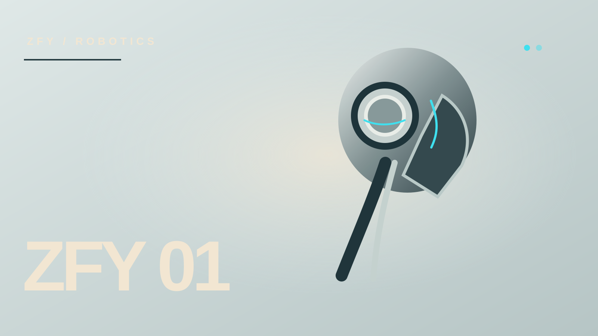

# ZFY 01

一个无构建步骤、无框架的单文件机器人产品 Hero 页面。页面以冷青灰背景、米白色 `ZFY 01` 巨型字标和石墨青聚光机甲构成视觉核心。

## 设计亮点

- **米白色 ZFY 01 字标**：用大尺度字标建立强烈的产品识别度，并通过左右分置形成横向张力。
- **冷青灰 + 石墨青配色**：背景保持克制，聚光区域切换到深色金属与青色发光线条，突出机甲结构。
- **聚光灯揭示交互**：鼠标移动或触摸按住时，聚光圈揭示暗色机甲图层；离开后恢复隐藏状态。
- **响应式构图**：桌面、平板和竖屏布局分别适配，保持字标和机器人主体的视觉焦点。
- **轻量实现**：所有 HTML、CSS 和原生 JavaScript 都在 `index.html` 中，无构建步骤、无框架、无外部 JS 库。

## 运行

直接打开 [`index.html`](./index.html) 即可预览。

## 技术说明

- CSS 使用 `clamp()`、媒体查询和 CSS mask 构建比例系统。
- 原生 WAAPI 负责一次性的入场动画。
- 外部资源仅包含字体样式表与机器人图片，页面本身不包含视频播放器。

